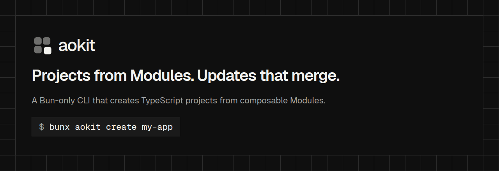

# aokit

<p align="center">
  <picture>
    <source media="(prefers-color-scheme: dark)" srcset="docs/brand/og/cover.png">
    <source media="(prefers-color-scheme: light)" srcset="docs/brand/og/cover-light.png">
    
  </picture>
</p>

<p align="center"><strong>Projects from Modules. Updates that merge.</strong></p>

<p align="center">
  <a href="https://github.com/andryorelabs/aokit/actions/workflows/ci.yml"></a>
  <a href="LICENSE"></a>
</p>

aokit is a Bun-only CLI that creates TypeScript projects from composable Modules and keeps them up to date. A Lockfile stores a hash for every generated file, so an update merges with your edits and never overwrites them.

> **Alpha.** aokit is pre-1.0. In 0.x a minor version may include breaking changes and a patch never does. See [Stability](docs/stability.md) and the [changelog](CHANGELOG.md).

## Supported platforms

The CLI runs on Bun 1.4.4 or newer, and the standalone binaries need no Bun. All of these are tested end to end:

- Linux x64 and arm64
- macOS arm64 and x64
- Windows x64

## Quickstart

Run `bunx aokit create my-app`, pick your Modules, and start the dev server.

```sh
bunx aokit create my-app
cd my-app && bun run dev
```

For a walkthrough, read [Getting started](docs/guide/getting-started.md). To extend aokit, read [Writing a Module](docs/guide/writing-modules.md) and [Hosting a Registry](docs/guide/hosting-a-registry.md).

## What you get

- **Pick Modules, get a project.** `aokit create` generates a TypeScript project from Modules such as next, vite-react, astro, hono, prisma, better-auth, tailwind4, shadcn, oxc, docker and coolify. The full list is in the [Module catalog](docs/architecture/module-catalog.md).
- **Updates keep your edits.** The Lockfile records a hash for every file, and `aokit update` merges changes with what you wrote.
- **See changes before they land.** `aokit diff` and `aokit check` show what would change.
- **Bun only.** aokit supports Bun and no other package manager.
- **Works inside coding agents.** `aokit mcp init` registers the aokit MCP server in Claude, Cursor, VS Code or Codex.
- **No telemetry.** The CLI, the MCP server and generated projects send no usage data.

The design is in [`docs/`](docs/): start with the [architecture overview](docs/architecture/overview.md) and the [glossary](GLOSSARY.md).

## Install the binary

Each [GitHub Release](https://github.com/andryorelabs/aokit/releases) attaches a standalone binary per platform, so you can run aokit without Bun. Download the one for your platform: `aokit-linux-x64`, `aokit-linux-arm64`, `aokit-darwin-arm64`, `aokit-darwin-x64` or `aokit-windows-x64.exe`.

On Linux and macOS, make it executable and put it on your `PATH`:

```sh
chmod +x aokit-linux-x64
mv aokit-linux-x64 ~/.local/bin/aokit
aokit --version
```

On Windows, rename `aokit-windows-x64.exe` to `aokit.exe`, move it to a directory on your `PATH` and run it from a new terminal:

```powershell
New-Item -ItemType Directory -Force $HOME\bin
Move-Item aokit-windows-x64.exe $HOME\bin\aokit.exe
aokit --version
```

Verify the download first, as described below.

## Verify a release

Each GitHub Release attaches standalone binaries and `SHA256SUMS`. Download the binaries you need and `SHA256SUMS` into one directory, then check the checksums and the build provenance attestation:

```sh
sha256sum -c SHA256SUMS --ignore-missing
gh attestation verify aokit-linux-x64 --repo andryorelabs/aokit
```

On macOS, use `shasum -a 256 -c SHA256SUMS --ignore-missing`. To try the npm pre-release instead, run `bunx create-aokit@next my-app`. Details are in [Distribution](docs/architecture/distribution.md#github-releases).

## Workspace

A Bun workspace with three packages:

| Package         | Path                    | Contents                                                     |
| --------------- | ----------------------- | ------------------------------------------------------------ |
| `aokit`         | `packages/aokit`        | The CLI (bin `aokit`) and the core, one entry per subsystem. |
| `create-aokit`  | `packages/create-aokit` | The `create-aokit` bin that runs `aokit create`.             |
| `@aokit/module` | `packages/module`       | The published Module manifest contract for Module authors.   |

## Development

Bun is the only supported package manager ([ADR 0006](docs/adr/0006-bun-only.md)).

```sh
bun install --frozen-lockfile
bun run check   # TypeScript 7 type check, oxlint --type-aware, oxfmt --check, knip
bun run test    # bun test
bun run lint    # oxlint --type-aware
bun run format  # oxfmt
```

Tooling follows [`docs/standards`](docs/standards/README.md): Oxfmt and Oxlint (exact `oxc` pin group), TypeScript 6 for API consumers plus the exact `typescript7` alias for type checking, husky with lint-staged and commitlint (conventional commits, gitmoji optional), and knip. Source comments are TSDoc blocks only, enforced by the `local/no-non-doc-comments` Oxlint jsPlugin in [`tools/oxlint`](tools/oxlint/local-plugin.ts).

## Contributing

Agents start at [AGENTS.md](AGENTS.md). Contributors read [CONTRIBUTING.md](CONTRIBUTING.md), [GOVERNANCE.md](GOVERNANCE.md), [CODE_OF_CONDUCT.md](CODE_OF_CONDUCT.md), [SUPPORT.md](SUPPORT.md) and the [blame ignore list](.git-blame-ignore-revs).

## Licence

[MIT](LICENSE)
