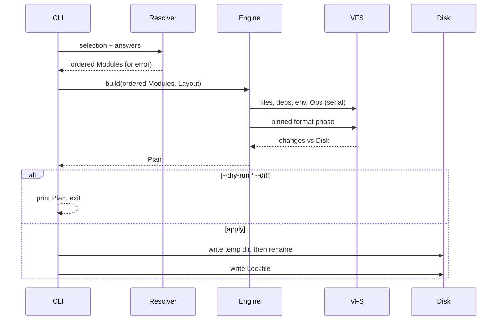

# Engine

The Engine turns an ordered list of Modules into a Plan and applies it. It never writes to disk until the Plan is accepted. Related: [overview](overview.md), [Module contract](module-contract.md), [Capabilities](capabilities.md), [Layouts](layouts.md).

## VFS and Plan before apply

The VFS is an in-memory tree. For `create` it starts empty; for `add`, `remove` and `update` it is loaded from the current Project. Modules run against the VFS only.

- `--dry-run` builds and prints the Plan and exits without writing.
- `--diff` prints the Plan as unified diffs per file.
- `update --plan` produces the same artifact for updates.
- The Plan is the same object whether it is printed or applied, so what the user reviewed is what is written.

### Change types and provenance

The Plan is a list of changes:

| Type | Meaning |
| --- | --- |
| `create` | New file. |
| `update` | Existing file with new content. |
| `delete` | File removed. |
| `rename` | File moved; content may also change. |

Each change records its provenance: the Module (and the file entry or Op) that caused it. When two Modules touch the same file, both appear in its provenance. Conflicting changes, such as two Modules creating the same path without an [`override`](module-contract.md#override), fail the Plan by default and name both Modules.

## Code edits: locate and splice

Ops that edit TypeScript do not use a general AST rewriter. They **locate** a position and **splice** text.

1. **Locate** with oxc-parser (AST and spans) or ast-grep (structural patterns) to find the anchor of an Extension point or a node such as an array literal.
2. **Splice** with magic-string against the original source.
3. All edits to one file from all Modules form one **batch** expressed in **original offsets**, so earlier edits never shift later ones.
4. **Overlap detection**: two edits whose ranges overlap, or two inserts at the same offset with no defined order, fail the Plan with both Modules named. Same-offset inserts from different Modules are ordered by the canonical Module order.

Further rules:

- magicast is used only for config-shaped objects (`export default defineConfig({...})`), where reading and writing a plain object is the whole job.
- ts-morph is optional and loaded lazily, only by a Module that needs type information. TypeScript 6 provides the JS API it needs; it is not on the default path and is not required on TypeScript 7.
- Generated snippets (imports, object literals) are produced as strings, then spliced; they are never reparsed unless an Op needs it.

## Non-TS patchers

| File | Patcher | Rule |
| --- | --- | --- |
| `tsconfig.json`, other JSONC | `jsonc-parser` | Edits preserve comments and formatting. |
| `package.json` | structural JSON merge plus sorted keys | Dependencies merged by name; keys emitted sorted. |
| YAML (workflows, compose) | `yaml` Document API | Edits keep comments and anchors. |
| Tailwind v4 CSS | postcss | Edits `@import`, `@plugin`, `@theme` at-rules. |
| `.env*` | line-based | Adds missing keys; **never overwrites** an existing key. |
| Markdown (`AGENTS.md`, docs) | marker regions | A Module owns the lines between its own start and end markers and nothing else. |

## No template engine

Source files in a Module are plain, valid files in their own language, so they can be linted and type-checked in the Module's own repository. The only substitutions are:

- `{{var}}` inside file content, replaced from the Module's answers. No conditionals, no loops.
- `__name__` inside file and directory names, replaced the same way (`__projectName__.config.ts`).

Variants are separate files selected by `files` entries, not branches inside one file.

## Ops catalog

An Op is a declarative edit applied at an Extension point or to a file. There are no inverse Ops: `remove` re-renders the Project without the Module and merges.

| Op | Effect |
| --- | --- |
| `addImport` | Adds a named, default or namespace import to a TS file, deduplicated. |
| `addToArray` | Appends or inserts an element in an array at an Extension point (`kind: array`). |
| `registerAt` | Registers an expression or call at an Extension point (provider, middleware, tool entry). |
| `mergeJson` | Deep-merges a value into a JSON/JSONC file; arrays union by value, keys sorted. |
| `mergeYaml` | Same for YAML through the Document API. |
| `addEnv` | Adds env keys without overwriting (also used by `env`). |
| `addCssAtRule` | Adds a Tailwind v4 at-rule through postcss. |
| `appendRegion` | Writes a marker region in a Markdown file. |

Every Op names its `target` (see [Layouts](layouts.md#targets)) and, for code Ops, the Extension point and the version range it supports.

## Determinism

The same inputs must produce the same bytes, so Plans can be hashed, compared and tested.

- **Canonical order.** Modules run in topological order of `requires`; ties break by Module name in Unicode codepoint order ([Capabilities](capabilities.md#resolution-order)).
- **Sorted emission.** Any collection the Engine emits (object keys, dependency lists, file list, Lockfile keys) is sorted.
- **Serial Ops.** Ops run one after another, never in parallel.
- **Injected environment.** `now`, `random` and `env` come from a context object passed to every Module, never from globals. Tests inject fixed values.
- **Volatile values.** Generated secrets and similar values are marked volatile and excluded from hashes.
- **LF.** All text is normalized to LF.
- **Pinned format phase.** After all Modules ran, the Project's formatter Module (at its Catalog version) formats the VFS. If the Project has no formatter Module, the phase is skipped.
- **No install.** Dependency installation happens after apply, outside the deterministic phase. The VFS never depends on `node_modules`.

CI generates every curated Project twice and compares hashes.

## Atomic writes

Apply writes the whole Plan to a temporary directory next to the target, then renames it into place; for existing Projects, files are renamed individually from the temporary directory. The Lockfile is written last. On SIGINT or any error before the final rename, the temporary directory is removed and the Project is unchanged. A half-written Project must not exist.
