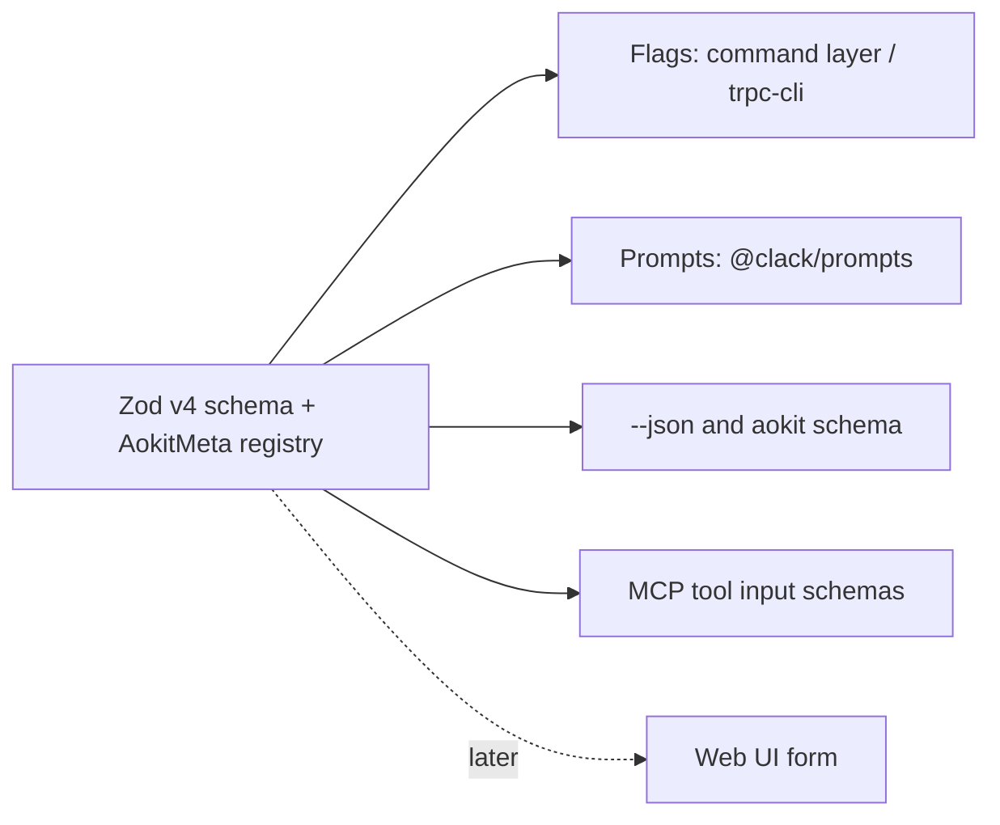

# Interfaces

aokit has several ways in: flags, interactive prompts, `--json`, an MCP server and, later, possibly a web UI. They are all generated from one Zod v4 schema, so a field is declared once and cannot drift between surfaces. Related: [overview](overview.md), [Module contract](module-contract.md), [Engine](engine.md), [CLI UX](cli-ux.md). Vocabulary follows [GLOSSARY.md](../../GLOSSARY.md).

## One schema, many surfaces



The input of each command (`create`, `add`, `remove`, `update`, ...) is one Zod schema. Presentation details that Zod does not carry live in a typed meta registry next to it.

### Typed meta registry

```ts
interface AokitMeta {
  flag?: string;          // long flag name; defaults to the kebab-cased key
  alias?: string;         // single-letter alias
  positional?: number;    // position among positional arguments
  prompt?: {              // how the interactive surface asks
    type: "text" | "select" | "multiselect" | "confirm";
    message: string;
  };
  group?: string;         // help section and prompt group
  hidden?: boolean;       // omitted from help, prompts and web UI; still accepted
  examples?: string[];    // real example values, reused by --help and tool descriptions
}

export const aokitMeta = z.registry<AokitMeta>();
```

Fields are registered with `.register(aokitMeta, {...})`, so the schema stays plain Zod and the meta never ends up in the validation path.

### Rules for schemas

- **Inputs must be JSON-Schema-representable.** Public command inputs use only types that `z.toJSONSchema(schema, { io: "input" })` can express: no transforms as the input side, no custom refinements without a documented equivalent, no functions or classes. `io: "input"` is used because the schema describes what a caller sends, not what the command computes after defaults.
- **Defaults live in the schema** (`.default(...)`), so flags, prompts, help and web UI show the same value, and `--yes` has exactly one source for them.
- **Enums come from data.** Module names, layouts and clients are enums built from the Registry index and the [Layouts](layouts.md) list, so completion, validation and MCP schemas agree.
- **Cross-field rules** (for example `--modules` against `--layout`) are expressed in the Resolver, not in schema refinements, so they produce the Resolver's [actionable errors](capabilities.md#error-messages) and do not leak into JSON Schema.
- **Outputs** have schemas too (the `data` of every result) and are exposed by `aokit schema`.

### Surfaces

| Surface | Driven by | Notes |
| --- | --- | --- |
| Flags | schema + `flag`, `alias`, `positional`, `group`, `hidden` | Parsed by trpc-cli behind the command layer below. |
| Prompts | schema + `prompt`, `group`, defaults | Only for fields the flags did not supply; see [CLI UX](cli-ux.md#principles). |
| `--json` | output schema | Same `{ok, data, error}` envelope as MCP. |
| `aokit schema` | `z.toJSONSchema(..., { io: "input" })` | See below. |
| MCP | the same JSON Schemas as tool input | See [MCP server](#mcp-server). |
| Web UI (possible, later) | JSON Schema + `prompt`, `group`, `examples` | Not designed in detail; the schema is the only contract it would need. |

### Command layer

trpc-cli converts a schema to flags, completion hooks and `--json`, but aokit does not call it from command code. An **own command layer** defines commands as `{ name, input: ZodSchema, output: ZodSchema, run(ctx, input) }`; one adapter binds that definition to trpc-cli. The reasons:

- trpc-cli can be replaced (citty, gunshi or a hand-written parser) by rewriting one adapter, with no change to commands, tests or the MCP server.
- Commands are plain functions of validated input, so the MCP server and tests call `run` directly without a process or argv.
- Exit codes, `--json` envelopes, the Ctrl+C hook and `onCancel` handling live in the layer, once ([CLI UX](cli-ux.md#exit-codes)).

The layer holds no generation logic: it calls the Registry client, Resolver and Engine of the [component map](overview.md#component-map).

### `aokit schema`

`aokit schema [command]` prints the JSON Schema of a command's input (and, with `--output`, its output) as JSON on stdout, generated with `z.toJSONSchema(schema, { io: "input" })` plus the meta registry under an `x-aokit` key (`flag`, `alias`, `positional`, `group`, `hidden`, `examples`). Without an argument it prints an index of all commands. It is the source for editor integrations, the web UI, the MCP `get_schema` tool and documentation, and is stable under the same versioning rule as the manifest schema ([Module contract](module-contract.md#schema-versioning)).

## MCP server

`aokit mcp` runs an MCP server over **stdio**, built on the MCP TypeScript SDK v2 (`registerTool` with Standard Schema, so the Zod schemas are used directly). It exposes the same commands through the command layer, with a stricter contract for agents.

### Rules

- **Plan before create.** `create` and `add` require that the same inputs were planned: the tool takes a `planId` (a hash of the normalized input, the resolved Release and the Plan's VFS hash) returned by `plan` / `plan_add`. The server remembers the ids it issued in the current session, re-plans the same input before writing, and rejects an unknown or no longer matching id with `PLAN_REQUIRED`, writing nothing. A plan therefore never survives a server restart, and the agent always has a reviewable [Plan](engine.md#vfs-and-plan-before-apply) before anything is written ([ADR 0019](../adr/0019-mcp-tools-take-an-explicit-schema-and-session-plan-ids.md)).
- **All fields explicit.** In MCP mode defaults are not applied silently. The tool input is derived mechanically from the command's Zod input (`toExplicitInput`): defaults are removed, every optional field is required and nullable ("none" is `null`), and the schema returned by `get_schema` marks them so. An agent must state each choice, which makes its action reproducible from the printed command and the Lockfile.
- **CLI-only fields are not exposed.** `dryRun`, `diff`, `yes`, `install` and `allowDirty` do not exist in MCP: the server never runs `bun install` (it returns `nextSteps` instead), never writes into a dirty tree and never prompts. `trust` and `registry` are explicit fields with the CLI's meaning; an untrusted Registry fails with an error whose `fix` names the `trust` field.
- **Absolute directory.** `directory` must be an absolute path; a relative one is `INVALID_INPUT`, because the server's working directory is not something an agent can know.
- **No stdout noise.** stdout carries only MCP protocol frames. Logs, progress and warnings go to stderr, or are returned inside the result. No spinner, prompt or color is ever initialized in this mode.
- **Uniform result.** Every tool returns `{ ok, data, error }`, with `error = { code, message, fix }` when `ok` is false, matching [`--json`](cli-ux.md#--json). Resolver failures are results, not protocol errors.
- **Annotations.** Read-only tools set `readOnlyHint: true`; `create` and `add` set `destructiveHint: true` because they write to disk.

### Tools

| Tool | Purpose | Input | `data` on success |
| --- | --- | --- | --- |
| `get_guidance` | How to use aokit correctly: vocabulary, the plan-before-create rule, how to choose Modules, which tools to call in what order. | `{ topic: "overview" \| "workflow" \| "modules" \| "layouts" \| "errors" }` | `{ topic, markdown }` |
| `get_schema` | JSON Schema for a command's input (the same output as `aokit schema`), plus the available Modules, Capabilities and Layouts. | `{ command: "create" \| "add" \| "remove" \| "update" }` | `{ command, inputSchema, modules: [{ name, version, provides, requires, conflicts }], layouts }` |
| `plan` | Resolve a new Project and return its Plan without writing. | the explicit `create` input (`directory`, `layout`, `modules`, `answer`, `registry`, `trust`, ...) | the `create` output data (`modules`, `plan`, `warnings`, `reproduce`, ...) plus `{ planId, nextSteps }` |
| `create` | Apply a previously planned `create`. Writes the Project. `destructiveHint: true`. | the explicit `create` input plus `{ planId }` | the `create` output data plus `{ nextSteps }` |
| `plan_add` | Resolve adding Modules to an existing Project (read from its Lockfile) and return the Plan. | the explicit `add` input | the `add` output data (`added`, `pulledIn`, `conflicts`, `plan`, `reproduce`, ...) plus `{ planId, nextSteps }` |
| `add` | Apply a previously planned `add`. Writes files and the Lockfile. `destructiveHint: true`. | the explicit `add` input plus `{ planId }` | the `add` output data plus `{ nextSteps }` |

Notes:

- `plan.changes` entries are the [Plan](engine.md#change-types-and-provenance) objects: `type` is `create | update | delete | rename`, with per-Module provenance in `provenance`. The tool outputs reuse the command output schemas, so they cannot drift from `--json`.
- `reproduce` is the printed reproducible command, so the agent can tell the user exactly what ran.
- `answer` keeps the CLI shape: a list of `module.key=value` strings.
- `nextSteps` is data (for example `bun install`); the server never runs the install, as it is outside the [deterministic phase](engine.md#determinism).
- `remove` and `update` are CLI-only in v1: they can leave merge conflicts that need a human, which does not fit a single-shot tool call.
- `error.code` is a stable specific code (`CAPABILITY_CONFLICT`, `PLAN_REQUIRED`, `DIRTY_TREE`, ...). Each code belongs to one category of the [exit-code table](cli-ux.md#exit-codes) (usage, resolution, precondition, failure), which is what the CLI turns into its exit code; MCP has no exit codes, so the specific code is the contract.
Example result (`plan`, failing resolution):

```json
{
  "ok": false,
  "data": null,
  "error": {
    "code": "CAPABILITY_CONFLICT",
    "message": "capability `orm` allows at most one provider; selected: prisma, drizzle",
    "fix": "remove one of prisma, drizzle from `modules` and call `plan` again"
  }
}
```

### `aokit mcp init`

`aokit mcp` with no subcommand starts the server; `aokit mcp init --client <claude|cursor|vscode|codex>` writes the client's MCP configuration so the server starts with `bunx aokit mcp`:

| Client | File written | Server key |
| --- | --- | --- |
| `claude` | `.mcp.json` in the project (or `claude mcp add` instructions with `--print`) | `mcpServers` |
| `cursor` | `.cursor/mcp.json` | `mcpServers` |
| `vscode` | `.vscode/mcp.json` | `servers`, with `type: "stdio"` |
| `codex` | prints the `~/.codex/config.toml` block and writes nothing (`--write` is deferred) | `mcp_servers` |

The command merges into an existing file without touching other servers or comments (the JSONC patcher of the [non-TS patchers](engine.md#non-ts-patchers)), is a no-op on a second run, honors `--dry-run`, and prints the exact change. A file that is not valid JSONC fails with `INVALID_CONFIG` and is left unchanged. With `--json` it returns `{ client, path, changed, content }`.

## Agent files in generated Projects

Generated Projects ship files that tell coding agents how the Project is built, so the agent works with aokit instead of around it.

- **`AGENTS.md`** at the Project root, with one section per Module. Each Module contributes its own section through an `appendRegion` [Op](engine.md#ops-catalog): the Module owns only the lines between its start and end markers, so adding or removing a Module never edits another Module's section ([Goals](overview.md#goals)). A short generated header lists the Project's Layout and the aokit commands (`aokit add`, `aokit check`, `aokit doctor`).
- **`CLAUDE.md`** containing the single line `@AGENTS.md`, so Claude Code reads the same content and the two cannot diverge.
- **Skills** at `.claude/skills/<name>/SKILL.md` (the agentskills.io format), contributed by Modules that have a workflow worth teaching (for example, how to add a database migration). A skill is a plain file owned by its Module, so `remove` deletes it like any other untouched file.
- Both files are `managed` for the generated regions and `seed` for the rest, so a user's own notes in `AGENTS.md` outside the markers survive `update`.

The MCP server and these files are complementary: the files serve an agent working inside a generated Project, and the MCP tools serve an agent creating or extending one.
