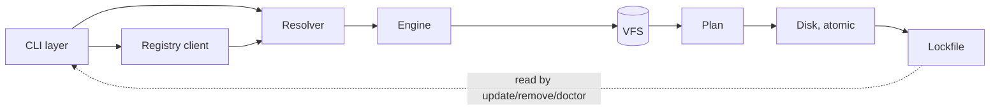

# Architecture overview

aokit turns a selection of Modules into a TypeScript Project and keeps that Project updatable. This page fixes the goals, the component map and the end-to-end flow. Vocabulary follows [CONTEXT.md](../../CONTEXT.md) exactly.

Detail lives in the sibling documents:

- [Module contract](module-contract.md): what a Module declares.
- [Capabilities](capabilities.md): how Modules relate and how compatibility is derived.
- [Engine](engine.md): the VFS, the Plan and the Ops that build files.
- [Layouts](layouts.md): how Targets become paths.

## Goals

1. **Adding a Module never edits other Modules.** A Module integrates through Capabilities, Extension points and Ops, never through another Module's source or a file path owned by someone else.
2. **Compatibility is derived, not enumerated.** No per-combination rules; see [Capabilities](capabilities.md#deriving-compatibility).
3. **Plan before apply.** Every change is built in the VFS, reviewable as a Plan, and written atomically.
4. **Deterministic.** The same inputs produce byte-identical output; see [Engine](engine.md#determinism).
5. **Layout is optional.** `single` or `monorepo`, chosen by the user; see [Layouts](layouts.md).
6. **Maintainable afterwards.** `add`, `remove` and `update` are designed together with the engine, not bolted on. They are specified in the lifecycle docs.

## Non-goals

- Bundles of choices. Reusable selections are the Lockfile of a real Project (`create --from`), not a maintained list.
- Integration between separate Projects. Separate repositories are separate Projects and cross-repo integration is not documented.
- A general template language. Source files are plain and valid; see [Engine](engine.md#no-template-engine).
- Inverse Ops. `remove` re-renders without the Module and merges; it never replays edits backwards.
- Package managers other than Bun, and stacks other than TypeScript.

## Component map

| Component | Responsibility |
| --- | --- |
| CLI layer | Parses flags and prompts from one schema, prints Plans, sets exit codes. Contains no generation logic. |
| Registry client | Fetches Module manifests and the Catalog from a Registry, verifies integrity, caches immutable versions. |
| Resolver | Takes the selected Modules plus answers, checks `provides`/`requires`/`conflicts` and Cardinality, orders Modules topologically, and fails with actionable errors. Pure: no I/O. |
| Engine | Builds the Plan in the VFS by running each Module's `files` and Ops in canonical order, then applies it atomically. |
| Lockfile | `aokit.lock.json`: records Layout, Modules with version, source and integrity, answers, per-file hash and Ownership mode, dependency pins. Read by `update`, `remove` and `doctor`. |

## The `create` and `add` flow

1. **Collect.** The CLI layer gathers the Layout, selected Modules and answers, from flags, prompts or `--from <lockfile|url>`.
2. **Fetch.** The Registry client resolves each Module to an exact version and verifies its integrity.
3. **Resolve.** The Resolver validates Capabilities and Cardinality and produces the canonical Module order. For `add`, the Lockfile's existing Modules are part of the input, so the new Module is checked against the whole Project.
4. **Build.** The Engine starts an empty VFS (for `add`, the current Project loaded into it) and runs each Module in order: emit `files` into their Targets, apply `deps` and `env`, apply Ops at Extension points.
5. **Plan.** The VFS diff against disk becomes the Plan: a list of create, update, delete and rename changes with per-Module provenance. `--dry-run` and `--diff` stop here.
6. **Format.** A pinned format phase runs the Project's formatter Module over the VFS.
7. **Apply.** The Plan is written to a temporary directory and renamed into place. The Lockfile is written in the same atomic step.
8. **Install.** Dependencies are installed outside the deterministic phase, after apply.

`update` and `remove` reuse steps 2 to 7, rendering the old and new states and merging them with the user's files.

## Mapping to the glossary

| Concept | Where it appears |
| --- | --- |
| Module | The unit declared by a manifest ([Module contract](module-contract.md)); the input of every flow step. |
| Capability, Cardinality | `provides`/`requires`/`conflicts` and per-Capability limits ([Capabilities](capabilities.md)); consumed by the Resolver. |
| Extension point | Declared by base Modules, targeted by other Modules' Ops ([Capabilities](capabilities.md#extension-points)). |
| Op | Declarative edit applied by the Engine ([Engine](engine.md#ops-catalog)). |
| Target, Layout | Logical destinations and their resolution to paths ([Layouts](layouts.md)). |
| VFS, Plan | The in-memory build and its reviewable result ([Engine](engine.md#vfs-and-plan-before-apply)). |
| Registry, Catalog, Toolchain pin group | Provided by the Registry client; the pin group is part of the Catalog ([Module contract](module-contract.md#deps)). |
| Lockfile, Ownership mode | Written at apply; drives later lifecycle commands. |
