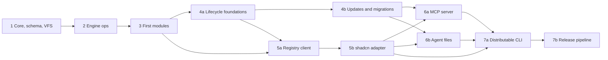

# Roadmap

Implementation phases for the next `/forge` runs, with the testing strategy for aokit itself. The phases build the components of the [overview](architecture/overview.md#component-map) in dependency order. Decisions are in the [ADRs](adr/README.md); the [module catalog](architecture/module-catalog.md) is illustrative and this roadmap decides which Modules ship first. Terms follow [GLOSSARY.md](../GLOSSARY.md).

## Phases

| Phase | Depends on | Delivers |
| --- | --- | --- |
| 1. Core + schema + VFS | none | Manifest schema, Resolver, VFS and Plan, command layer, Lockfile read/write. |
| 2. Engine ops | 1 | Edit engine and Ops catalog. |
| 3. First modules | 1, 2 | A curated set of Modules and an end-to-end `create`. |
| 4a. Lifecycle foundations | 3 | Merger, merge procedure, `add`, `remove`, `recopy`, `doctor`, `diff`, `check`, `eject`, `restore`, `create --from`. |
| 4b. Updates and migrations | 4a | `update`, migrations, renames, upgrade job. |
| 5a. Registry client | 3, 4a | Remote and `github:` Registries, cache, Pins, trust, yank, `create --from <url>`. |
| 5b. shadcn adapter | 5a | Adapter, namespaces, `registryDependencies`. |
| 6a. MCP server | 4b, 5b | MCP server, `aokit schema`, `aokit mcp init`. |
| 6b. Agent files | 4b, 5b | Agent files in generated Projects. |
| 7a. Distributable CLI | 5b, 6a, 6b | npm packages, standalone binary, update notices, binary tests. |
| 7b. Release pipeline | 7a | Publishing, provenance, checksums, attestations, releases. |

### 1. Core + schema + VFS

Scope: `defineModule()` and the manifest JSON Schema with `schemaVersion` ([Module contract](architecture/module-contract.md)); the Resolver (Capabilities, Cardinality, `conflicts`, canonical order, actionable errors, [Capabilities](architecture/capabilities.md)); the VFS, Plan with change types and provenance, atomic apply, the injected context (`now`, `random`, `env`) ([Engine](architecture/engine.md)); Layout resolution tables ([Layouts](architecture/layouts.md)); the Lockfile schema with sorted keys and chained migrations ([Lockfile](architecture/lockfile.md)); the own command layer with Zod schemas and the typed meta registry ([Interfaces](architecture/interfaces.md)); exit codes and the `{ok, data, error}` envelope ([CLI UX](architecture/cli-ux.md)).

Exit criteria:

- Resolver unit tests cover every rule and error message in Capabilities, with no I/O.
- A Plan built twice from the same inputs has an identical hash.
- Atomic apply leaves the Project unchanged on a simulated SIGINT.
- A command defined in the command layer runs through the trpc-cli adapter and by direct `run` call with the same result.

### 2. Engine ops

Scope: locate-and-splice with oxc-parser or ast-grep and magic-string, batch edits in original offsets, overlap detection; magicast for config objects; the non-TS patchers (jsonc-parser, `yaml`, postcss, `.env`, markdown regions); the Ops catalog; `{{var}}` and `__name__` interpolation; the pinned format phase ([Engine](architecture/engine.md#code-edits-locate-and-splice)).

Exit criteria:

- Each Op has VFS tests, including idempotence and a deduplicated second application.
- Two Modules inserting at the same offset produce the canonical order; overlapping edits fail naming both Modules.
- `.env` patching never overwrites an existing key.
- The locate step is covered by fixture-set span tests on the native oxc build; the npm package and the binary run the same parser ([ADR 0010](adr/0010-locate-and-splice-edit-engine.md)).

### 3. First modules

Scope: a small curated set chosen from the [module catalog](architecture/module-catalog.md) that exercises every mechanism: a formatter/linter Module (`oxc`, with the `oxc` Toolchain pin group), a web base with Extension points, a server base, a Module contributing through Ops, and one Module per Cardinality case. Local Registry only. `create` end to end with `--dry-run`, `--diff`, `--yes` and `--json`; the first Catalog (`catalog/<release>.json`).

Exit criteria:

- Every Module has VFS tests and its plain source files lint and type-check in the Module's own repository.
- The capability-derived matrix runs on both Layouts with snapshots.
- Generate-twice determinism passes on Linux and macOS.
- The curated set builds and type-checks for real.
- `create` works with no prompts through `--yes --json`.

### 4. Lifecycle

Phase 4 is split into two specs that ship in order. Both build on the same parts: the [Merger](architecture/lockfile.md#merge-policy), the [merge procedure](architecture/lifecycle.md#the-merge-procedure) and the [Lockfile](architecture/lockfile.md).

#### 4a. Lifecycle foundations

Scope: a versioned, immutable local Registry with one unified `sha256-<hex>` integrity ([Registry](architecture/registry.md)); Lockfile v2 (`selected`, dependency `owners`) with the v1 to v2 migration; the Render from a Lockfile; lifecycle outcomes as error codes with data ([ADR 0015](adr/0015-lifecycle-outcomes-are-error-codes-with-data.md)); the git adapter and the clean-tree precondition; the `Merger` interface with `git merge-file`, `node-diff3`, binary `.aokit-new` and structural JSON; the VFS-to-VFS merge procedure; transactional apply with a stash of originals; `doctor` (read-only), `diff`, `check`, `eject`, `restore`, `add`, `remove`, `recopy` and `create --from <path>`; the Docker image built and run in CI ([Lifecycle](architecture/lifecycle.md)).

Exit criteria:

- `remove` of every curated Module, in each curated selection and both Layouts, leaves a Project equal to a fresh render without it (and without any cascaded Modules), when no user edits exist.
- Every merge-policy case (text, binary, JSON, delete versus modify, an unknown file at a new path, `bun.lock`) behaves as the [merge policy](architecture/lockfile.md#merge-policy) states.
- `doctor` reports `pristine`, `modified`, `deleted`, `unknown` and `volatile` correctly and exits `1` with the `DRIFT` outcome on drift.
- Exit codes 1, 2, 3, 4, 5 and 6 behave as the [exit code table](architecture/cli-ux.md#exit-codes) says, each asserted end to end.
- A v1 Lockfile reads as v2 without being rewritten until the next apply.
- `create` followed by `add`, `doctor`, an edit, `diff`, `restore` and `remove` works in a temporary directory.

#### 4b. Updates and migrations

Scope: `update` with `--plan`, `--apply` and `--abort`; Module migrations; the renames manifest; `diff --to <release>`; the N-1 to N upgrade job ([Lifecycle](architecture/lifecycle.md#update)).

Exit criteria:

- The upgrade job (release N-1 to N, representative edits, zero conflicts) is green for the curated set.
- `update --plan` followed by `--apply` writes exactly the reviewed Plan, and `--abort` restores the pre-update state.
- A Module migration can rename an answer and a renames manifest carries a user's edit across a moved file.

`layout migrate` stays deferred until `update` works, since it reuses the merge procedure ([Deliberately deferred](#deliberately-deferred)).

### 5. Registry

Phase 5 is split into two specs that ship in order. Both build on the [Registry protocol](architecture/registry.md).

#### 5a. Registry client

Scope: one Registry client over `bundled`, local, `https://` URL and `github:owner/repo#ref` sources, read lazily with integrity checks; the optional cache keyed by integrity; Pins for git sources; the trust prompt, the user config allowlist, `--trust` and the Lockfile `trusted` field; `minCliVersion`; yanked versions; `--registry` on `create`, `add` and `update`; `create --from <url>`; a per-Release Module version map in the Catalog ([ADR 0017](adr/0017-remote-registries-over-the-local-layout.md)).

Exit criteria:

- An integrity mismatch is a hard error naming Registry, Module and values.
- A non-interactive run against an untrusted Registry fails with the exact `--trust` form, and `--yes` never grants trust.
- A Module is fetched from a remote Registry, cached, and a read-only command works offline from a warm cache.
- An old Module version is fetched and verified from the Lockfile record.
- A `github:` source is recorded at its Pin and only `update --registry` moves it.
- A yanked version is never selected and still verifies for an existing Lockfile.

#### 5b. shadcn adapter

Scope: the shadcn adapter with item type mapping, alias placeholders and `registryDependencies`, and namespaced Registries with `${VAR}` auth ([Registry](architecture/registry.md#shadcn-adapter), [ADR 0018](adr/0018-shadcn-items-are-adapted-modules.md)). The `registry:base` and `registry:font` item types are deferred. The phase also wires `op` overrides in the Engine and adds the `addCssVariables` Op.

Exit criteria:

- A shadcn item installs through the adapter and is covered by `update`, `doctor` and `remove`.
- A namespaced Registry sends its headers only to its own host and never records expanded values.

### 6. MCP and agent files

Phase 6 is split into two specs. Both build on [Interfaces](architecture/interfaces.md).

#### 6a. MCP server

Scope: `aokit schema` (already shipped); the MCP server (stdio) with `get_guidance`, `get_schema`, `plan`, `create`, `plan_add`, `add`, with explicit inputs derived from the command schemas and session-scoped plan ids ([ADR 0019](adr/0019-mcp-tools-take-an-explicit-schema-and-session-plan-ids.md)); `aokit mcp init --client` for claude, cursor and vscode, with codex printed only ([Interfaces](architecture/interfaces.md#mcp-server)).

Exit criteria:

- MCP tool input schemas are generated from the same Zod schemas as the flags, and a test fails if they drift.
- A plan-then-create session through MCP works with all fields explicit and no stdout noise.
- `create` or `add` with an unknown or stale `planId` fails with `PLAN_REQUIRED` and writes nothing.
- `mcp init` merges into an existing client config without touching other servers.

#### 6b. Agent files

Scope: `AGENTS.md` (and `CLAUDE.md` as `@AGENTS.md`) with an aokit-owned header and per-Module Regions, and skills in generated Projects, as Region files with a Region-aware Merger, hash and adoption of hand-written files ([Interfaces](architecture/interfaces.md#agent-files-in-generated-projects), [ADR 0020](adr/0020-agent-files-are-region-files-merged-by-region.md)); a Region for each curated Module and Adapted Module, one skill (`hono`), `SKILL.md` validation in `registry:build`, Release `2026.11.2`, and the Upgrade job testing the last Release pair.

Exit criteria:

- Generated agent files contain one section per selected Module and are updated by `add` and `remove`.
- A user's notes outside the markers survive `add`, `remove` and `update` and are not reported as drift.
- A hand-written `AGENTS.md` is adopted by `update` with no Conflict.
- The Upgrade job (`2026.11.1` to `2026.11.2`, with a user note appended to `AGENTS.md`) is green.

### 7. Distribution

Phase 7 is split into two specs that ship in order. Both build on [Distribution](architecture/distribution.md).

#### 7a. Distributable CLI

Scope: the `aokit` package built to `dist/` with the first-party Registry inside, the `create-aokit` package, the standalone binary (native oxc-parser and oxfmt embedded per target, Registry embedded and extracted, dotenv and bunfig autoload off), update notices, `--version --json` and the `minCliVersion` fix text, an `AOKIT_BIN` override for the process tests, a linux-x64 `Distribution` workflow, and SHA-pinned actions in every workflow.

Exit criteria:

- A tarball installed outside the repository runs `aokit create` and `create-aokit` with the same result as the source.
- The linux-x64 binary passes the process tests (`AOKIT_BIN`) and the `create`, `add`, `remove` and `update` e2e with `--yes --json`, and its determinism digest equals the npm package's.
- The binary does not load `.env` or `bunfig.toml` from the working directory.
- Two parallel first runs of the binary leave one intact extracted Registry.

#### 7b. Release pipeline

Scope: the release workflow with bumpp and changelogithub, npm trusted publishing with provenance, the five-target build matrix, `SHA256SUMS` and attestations, e2e on native linux-x64, linux-arm64 and macOS arm64 runners, publishing the Registry release with the CLI. It starts after the repository is public and the first `0.1.0-next.0` publish by token is done.

Exit criteria:

- A release dry run publishes with provenance and attaches verifiable checksums and attestations.
- `bunx create-aokit` and `bunx aokit add` work from a published pre-release.
- Windows and darwin-x64 binaries are published without an e2e run, and the release notes say so.

## Testing strategy

| Layer | What it proves | Runs |
| --- | --- | --- |
| Per-Module VFS tests | A Module's files, deps, env and Ops produce the expected tree in the VFS, alone and on a minimal base, with no disk or network. | Every PR. |
| Capability-derived matrix with snapshots | Valid selections (pairwise) crossed with both Layouts generate a stable tree; an unintended output change shows as a reviewed snapshot diff ([versions](architecture/versions.md#ci)). | Every PR. |
| Generate-twice determinism hash | Two runs give one digest, and the digest is the same on Linux and macOS, for the npm build and the binary ([Distribution](architecture/distribution.md#ci-determinism-on-linux-and-macos)). | Every PR, on both operating systems. |
| Real build and typecheck of a curated set | Generated Projects install, build and type-check. Slower, so a subset. | Every PR for the core set; the wider set on release. |
| Upgrade job | Release N-1 to N produces zero conflicts after representative edits. | Every Registry release. |
| Binary e2e with `--yes --json` | The compiled binary runs `create`, `add`, `remove` and `update` non-interactively and returns valid envelopes and exit codes. | Every release. |
| Docs index invariant | Every ADR is indexed, every link exists, required sections are present ([docs and forge](standards/docs-and-forge.md#living-adrs)). | Every PR. |

## Deliberately deferred

- A web UI. The schema is the only contract it would need ([Interfaces](architecture/interfaces.md#surfaces)).
- `layout migrate`. It is specified, but it follows phase 4b once `update` works, since it reuses the merge procedure.
- Telemetry ([ADR 0013](adr/0013-no-telemetry-in-v1.md)).
- A supported Node install path. Bun APIs sit behind an adapter, but generated Projects require Bun ([ADR 0006](adr/0006-bun-only.md)).
- Modules outside the first curated set. The catalog is illustrative, not a commitment.
- Cross-repo integration between Projects, and Python, C++ and Swift stacks (out of scope).
- Revisiting changesets, only if packages must version independently ([Distribution](architecture/distribution.md#release-tooling)).
- Dropping the Bun catalog workaround, once Renovate supports Bun catalogs ([versions](architecture/versions.md#renovate-and-the-registry-catalog)).
