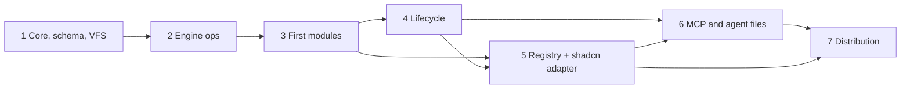

# Roadmap

Implementation phases for the next `/forge` runs, with the testing strategy for aokit itself. No code exists yet. The phases build the components of the [overview](architecture/overview.md#component-map) in dependency order. Decisions are in the [ADRs](adr/README.md); the [module catalog](architecture/module-catalog.md) is illustrative and this roadmap decides which Modules ship first. Terms follow [CONTEXT.md](../CONTEXT.md).

## Phases

| Phase | Depends on | Delivers |
| --- | --- | --- |
| 1. Core + schema + VFS | none | Manifest schema, Resolver, VFS and Plan, command layer, Lockfile read/write. |
| 2. Engine ops | 1 | Edit engine and Ops catalog. |
| 3. First modules | 1, 2 | A curated set of Modules and an end-to-end `create`. |
| 4. Lifecycle | 3 | `add`, `remove`, `update`, `doctor` and friends. |
| 5. Registry + shadcn adapter | 3, 4 | Registry client, integrity, trust model, adapter. |
| 6. MCP and agent files | 4, 5 | MCP server, `aokit schema`, agent files in generated Projects. |
| 7. Distribution | 5, 6 | Binary, publishing, releases. |

### 1. Core + schema + VFS

Scope: `defineModule()` and the manifest JSON Schema with `schemaVersion` ([Module contract](architecture/module-contract.md)); the Resolver (Capabilities, Cardinality, `conflicts`, canonical order, actionable errors, [Capabilities](architecture/capabilities.md)); the VFS, Plan with change types and provenance, atomic apply, the injected context (`now`, `random`, `env`) ([Engine](architecture/engine.md)); Layout resolution tables ([Layouts](architecture/layouts.md)); the Lockfile schema with sorted keys and chained migrations ([Lockfile](architecture/lockfile.md)); the own command layer with Zod schemas and the typed meta registry ([Interfaces](architecture/interfaces.md)); exit codes and the `{ok, data, error}` envelope ([CLI UX](architecture/cli-ux.md)).

Exit criteria:

- Resolver unit tests cover every rule and error message in Capabilities, with no I/O.
- A Plan built twice from the same inputs has an identical hash.
- Atomic apply leaves the Project unchanged on a simulated SIGINT.
- A command defined in the command layer runs through the trpc-cli adapter and by direct `run` call with the same result.

### 2. Engine ops

Scope: locate-and-splice with oxc-parser or ast-grep and magic-string, batch edits in original offsets, overlap detection; magicast for config objects; the non-TS patchers (jsonc-parser, `yaml`, postcss, `.env`, markdown regions); the Ops catalog; `{{var}}` and `__name__` interpolation; the pinned format phase ([Engine](architecture/engine.md#code-edits-locate-and-splice)).

Exit criteria:

- Each Op has VFS tests, including idempotence and a deduplicated second application.
- Two Modules inserting at the same offset produce the canonical order; overlapping edits fail naming both Modules.
- `.env` patching never overwrites an existing key.
- The locate step gives identical spans with the native and WASM oxc builds on a fixture set.

### 3. First modules

Scope: a small curated set chosen from the [module catalog](architecture/module-catalog.md) that exercises every mechanism: a formatter/linter Module (`oxc`, with the `oxc` Toolchain pin group), a web base with Extension points, a server base, a Module contributing through Ops, and one Module per Cardinality case. Local Registry only. `create` end to end with `--dry-run`, `--diff`, `--yes` and `--json`; the first Catalog (`catalog/<release>.json`).

Exit criteria:

- Every Module has VFS tests and its plain source files lint and type-check in the Module's own repository.
- The capability-derived matrix runs on both Layouts with snapshots.
- Generate-twice determinism passes on Linux and macOS.
- The curated set builds and type-checks for real.
- `create` works with no prompts through `--yes --json`.

### 4. Lifecycle

Scope: `add`, `remove`, `update` (`--plan`, `--apply`, `--abort`), `check`, `doctor`, `eject`, `restore`, `diff`, `recopy`, `create --from`; the clean-tree precondition; the `Merger` interface with `git merge-file` and `node-diff3`; per-file hashes and ownership modes; Module migrations and the renames manifest ([Lifecycle](architecture/lifecycle.md)).

Exit criteria:

- `remove` of every first Module leaves a Project equal to a fresh render without it, when no user edits exist.
- Conflict cases (delete versus modify, binary, JSON, lockfile) behave as the [merge policy](architecture/lockfile.md#merge-policy) states.
- The upgrade job (release N-1 to N, representative edits, zero conflicts) is green for the curated set.
- `doctor` reports `pristine`, `modified`, `deleted` and `unknown` correctly and exits non-zero on drift.
- Exit codes 2, 5 and 6 behave as the [exit code table](architecture/cli-ux.md#exit-codes) says.

### 5. Registry + shadcn adapter

Scope: the Registry client for `official`, `local` and `remote` kinds, integrity checks, immutability and the optional cache, commit-SHA pinning, the trust prompt and allowlist, `minCliVersion`; the shadcn adapter with item type mapping, alias placeholders and `registryDependencies` ([Registry](architecture/registry.md)).

Exit criteria:

- An integrity mismatch is a hard error naming Registry, Module and values.
- A non-interactive run against an untrusted Registry fails with the exact `--trust` form, and `--yes` never grants trust.
- A shadcn item installs through the adapter and is covered by `update`, `doctor` and `remove`.
- An old Module version is fetched and verified from the Lockfile record.

### 6. MCP and agent files

Scope: `aokit schema`; the MCP server (stdio) with `get_guidance`, `get_schema`, `plan`, `create`, `plan_add`, `add`; `aokit mcp init --client`; `AGENTS.md` (and `CLAUDE.md` as `@AGENTS.md`) with per-Module sections, and skills in generated Projects ([Interfaces](architecture/interfaces.md#mcp-server)).

Exit criteria:

- MCP tool input schemas are generated from the same Zod schemas as the flags, and a test fails if they drift.
- A plan-then-create session through MCP works with all fields explicit and no stdout noise.
- Generated agent files contain one section per selected Module and are updated by `add` and `remove`.

### 7. Distribution

Scope: `create-aokit` and `aokit` packages, the `bun build --compile` binaries, npm trusted publishing with provenance, `SHA256SUMS` and attestations, the release workflow with bumpp and changelogithub ([Distribution](architecture/distribution.md)).

Exit criteria:

- The binary passes the e2e suite and the determinism digest matches the npm build.
- The binary does not load `.env` or `bunfig.toml` from the working directory.
- A release dry run publishes with provenance and attaches verifiable checksums and attestations.
- `bunx create-aokit` and `bunx aokit add` work from a published pre-release.

## Testing strategy

| Layer | What it proves | Runs |
| --- | --- | --- |
| Per-Module VFS tests | A Module's files, deps, env and Ops produce the expected tree in the VFS, alone and on a minimal base, with no disk or network. | Every PR. |
| Capability-derived matrix with snapshots | Valid selections (pairwise) crossed with both Layouts generate a stable tree; an unintended output change shows as a reviewed snapshot diff ([versions](architecture/versions.md#ci)). | Every PR. |
| Generate-twice determinism hash | Two runs give one digest, and the digest is the same on Linux and macOS, for the npm build and the binary ([Distribution](architecture/distribution.md#ci-determinism-on-linux-and-macos)). | Every PR, on both operating systems. |
| Real build and typecheck of a curated set | Generated Projects install, build and type-check. Slower, so a subset. | Every PR for the core set; the wider set on release. |
| Upgrade job | Release N-1 to N produces zero conflicts after representative edits. | Every Registry release. |
| Binary e2e with `--yes --json` | The compiled binary runs `create`, `add`, `remove` and `update` non-interactively and returns valid envelopes and exit codes. | Every release. |
| Docs index invariant | Every ADR is indexed, every link exists, required sections are present ([docs and forge](standards/docs-and-forge.md#living-adrs)). | Every PR. |

## Deliberately deferred

- A web UI. The schema is the only contract it would need ([Interfaces](architecture/interfaces.md#surfaces)).
- `layout migrate`. It is specified, but it follows the lifecycle phase once `update` works, since it reuses the merge procedure.
- Telemetry ([ADR 0013](adr/0013-no-telemetry-in-v1.md)).
- A supported Node install path. Bun APIs sit behind an adapter, but generated Projects require Bun ([ADR 0006](adr/0006-bun-only.md)).
- Modules outside the first curated set. The catalog is illustrative, not a commitment.
- Cross-repo integration between Projects, and Python, C++ and Swift stacks (out of scope).
- Revisiting changesets, only if packages must version independently ([Distribution](architecture/distribution.md#release-tooling)).
- Dropping the Bun catalog workaround, once Renovate supports Bun catalogs ([versions](architecture/versions.md#renovate-and-the-registry-catalog)).
