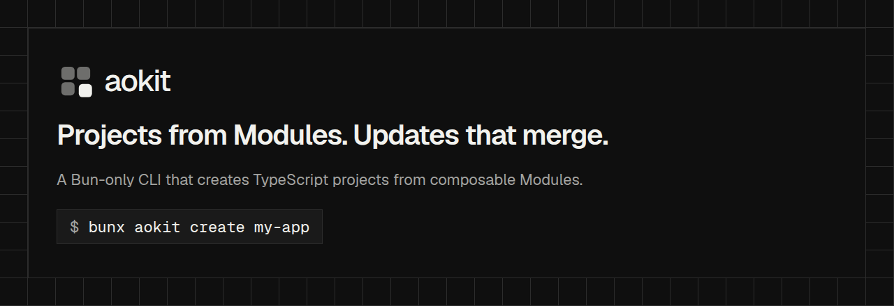

# aokit



**Projects from Modules. Updates that merge.**

The aokit CLI: it creates projects from Modules and keeps them up to date.

```sh
bunx aokit create my-app
```

The package runs on Bun (>=1.4.4) and ships its Registry under `registry/`.
