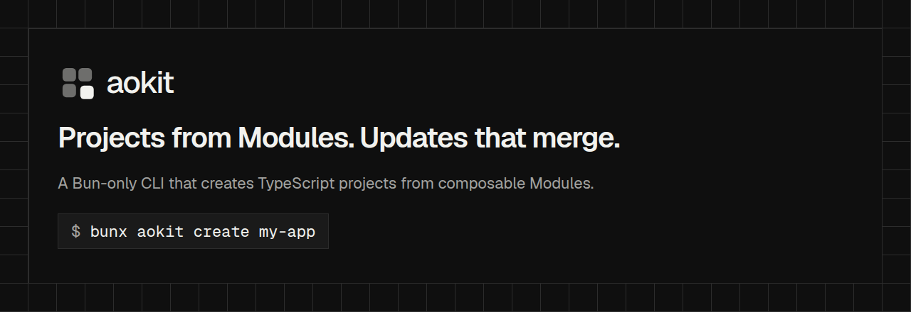

# create-aokit



**Projects from Modules. Updates that merge.**

Scaffolds a new aokit project. It runs the `aokit create` command of the `aokit` package.

```sh
bunx create-aokit my-app
```

The bin is plain JavaScript and starts under Node, but it hands the work to `aokit`, which needs Bun (>=1.4.4) on `PATH`.
