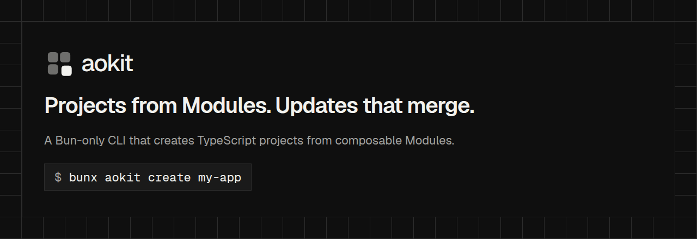

# @aokit/module



**Projects from Modules. Updates that merge.**

The Module manifest contract for [aokit](https://github.com/andryorelabs/aokit). Module authors use it to declare a Module with full types: its name, version, dependencies, Extension points and declarative ops.

```sh
bun add -d @aokit/module
```

```ts
import { defineModule } from "@aokit/module";

export default defineModule({
  name: "my-module",
  version: "1.0.0",
  ops: [
    {
      op: "mergeJson",
      target: "root",
      file: "package.json",
      value: { scripts: { hello: "echo hello" } },
    },
  ],
});
```

The package ships ESM JavaScript and TypeScript declarations. It shares its version with `aokit` and `create-aokit`; a manifest that this version validates is one the matching `aokit` CLI accepts.

Docs: [Module contract](https://github.com/andryorelabs/aokit/blob/main/docs/architecture/module-contract.md).
